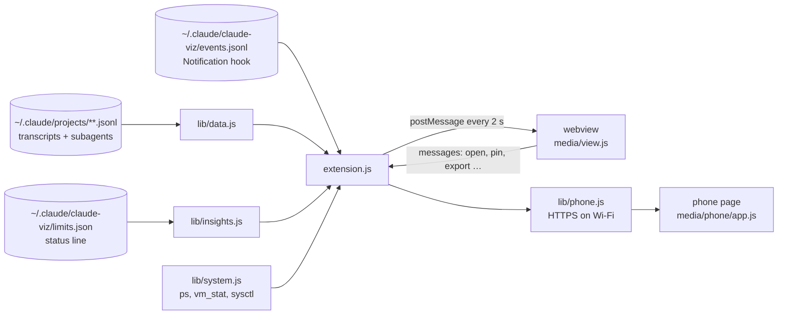

# Architecture

Agent Glasses has two halves: the **extension host** (Node.js inside VS Code) reads files and runs local
commands; the **webview** (the panel) only renders what the host posts to it. The phone page is a third,
read-only client of the same host data.

## Loops

| Interval | Work |
|---|---|
| 2 s | `data.snapshot()`: running sessions (last 400 KB of each transcript), subagents, recently finished; Notification events; post to views. |
| 5 s | `system.machine()`: CPU, memory, swap, disk, processes. |
| 30 s | `data.stats()`: incremental 14-day statistics (only new bytes are read), then the coach, achievements, recap, attribution, budget, weekly estimate; archive the day totals. |
| 10 min | Worktree scan (sizes via `du`). |
| On demand | Session insights (whole transcript, streamed), history list, full-text search (a streaming scan in Node), git view, exports. |

## Transcript facts the code relies on

- One JSON object per line. Assistant replies are written as one line per content block, each repeating
  the same `usage`; usage is counted once per `message.id`.
- `promptId` groups the lines of one turn. Messages typed while Claude works arrive as `queue-operation`
  lines; system notifications are queued the same way but start with `<`.
- `cost-state` lines carry `totalCostUSD` and per-model `modelUsage` with `costUSD`; they restart with
  each Claude Code process, so they are used to learn prices, not as session totals.
- Subagents live in `<session>/subagents/agent-*.jsonl` with a `.meta.json` (type, description,
  `toolUseId` of the spawning call, worktree). A subagent ends with a `SubagentHandback` call.
- `permissionDecision.source` starting with `user` marks a tool call you approved; `toolDenialKind`
  marks a denial; `compact_boundary` lines mark compactions; `thinkingDurationMs` gives thinking time.
- Claude Code appends untimestamped metadata to idle transcripts, so activity is taken from the last
  timestamped line, not the file's modification time.

## Webview rules

- The DOM is built with `createElement`/`textContent`; transcript text is never inserted as HTML. The
  Markdown renderer builds nodes too.
- Live redraws every 2 s but holds the redraw while you type in a box, select text or drag a card. Other
  tabs redraw only when their own data changes, so open dropdowns are not closed.
- Every message from the webview is checked by the host against what is on screen (session ids, file
  paths) before anything is opened or changed.
